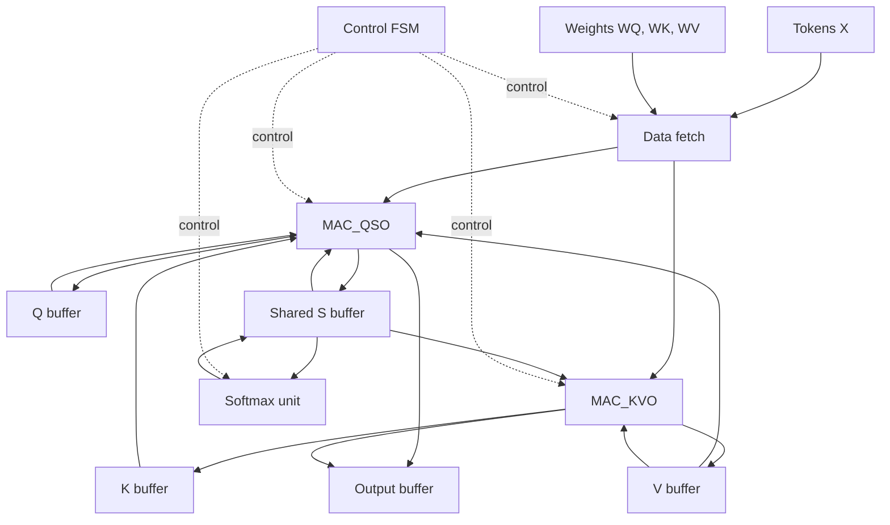

# Scaled Dot-Product Attention

Simplified scaled dot-product attention mechanism using Verilog 

## Toolchain

- **Simulator:** Icarus Verilog (`iverilog`), built from source [ICARUS Verilog](https://github.com/steveicarus/iverilog)
  - **Version:** Icarus Verilog version 14.0 (devel)
  - **Build Target:** MSYS2 UCRT64 environment (`x86_64-w64-mingw32`)
  - **OS:** Windows 10/11 (via MSYS2 UCRT64 Bash)
  - **Build Steps:** 
    1. Installed dependencies in MSYS2 UCRT64: `gcc`, `make`, `autoconf`, `bison`, `flex`, `gperf`.
    2. Cloned repository: 
        `git clone https://github.com/steveicarus/iverilog.git`
    3. Generated build scripts and configured target path: `autoconf && ./configure --prefix=/ucrt64`
    4. Compiled and installed binaries: `make install`

## Block diagram

The block diagram of the design for the scaled dot product attention is given below:



## File structure and Files

```
mac_unit.v
divider.v
softmax_unit.v
loop_control.v
attention.v
```

### mac_unit.v

- MAC (Multiply-Accumulate) unit multilpies two operands(`a` and `b`) and accumulates it on the accumulator (`acc`). At each clock pulse, it muliplies given two operands and then adds it to the accumulator.
- At each clock pulse, the MAC either resets the `acc`, clears the `acc`, accumulates `a*b` into `acc`, or holds `acc` as it is. Thhis depends on `rst_n`, `clr`, and `en` in the corresponding order.

### divider.v

- The divider uses restoring division algorithm. 

### softmax_unit.v

- The softmax function is a mapping that takes a vector of scores/numbers and maps it to a vector of corresponding probabilities.
- For a vector $\vec{z} = [z_1, z_2, z_3, ..., z_K]$, the softmax formual is as follows: $\sigma (\vec{z})_i = \frac{e^{z_i}}{\sum_{j=1}^{K}e^{z_j}}$
- Every output is in (0, 1).
- The outputs sum to 1.

#### Hardware Implementation
For each row of matrix `S`:
- Find maximum value in each row (`smax`)
- Compute $e^{S[i][j] - smax}$ for every column j, store it in buffer and accumulate the sum (`esum`).
- Divide each exponent value by the `esum`.

#### Why subtract max from each element?
If any $z_i$ is large (let it be 100), then $e^{100} \approx 2.7 \times 10^{43}$, which overflows any fixed-point or floating-point format. Even if only one value is large, the entire sum will blow up. So to overcome this, we subtract the maximum element of each row with individual elements of the row so that each element are less than or equal 0. This will bound the value of exponent from 0 to 1, making it easier to compute with no overflow.

$\sigma (\vec{z_i}) = \frac{e^{z_i}}{\sum_{j=1}^{K}e^{z_j}} = \frac{e^{z_i}*e^{-m}}{\sum_{j=1}^{K}e^{z_j}* e^{-m}} = \frac{e^{z_i-m}}{\sum_{j=1}^{K}e^{z_j-m}}$

Where, $m = max_k(z_k)$ is a constant for each row. With $m$ chosen as the row maximum, every exponent argument is $\le 0$.