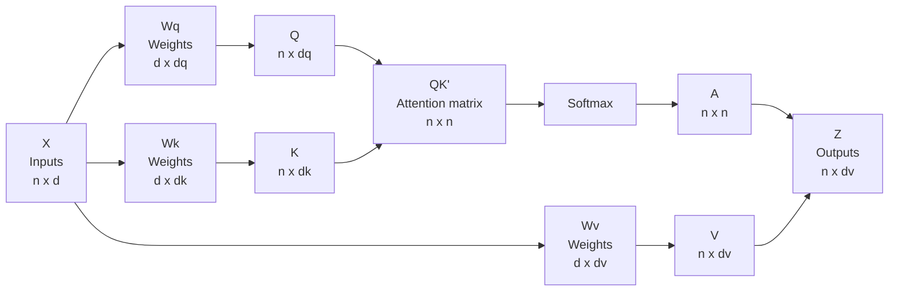
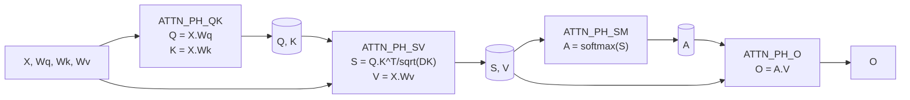

# Scaled Dot-Product Attention

Simplified scaled dot-product attention mechanism using Verilog .

The project implements scaled dot product attention as a hardware accelerator in Verilog, which is the operation inside transformer model. Given four input matrices $(X, Wq, Wk, Wv)$, the design computes $O = softmax(\frac{QK^{T}}{\sqrt{d_k}}) V$.

The block diagram below shows the attention calculation:



## Computation
N = Number of tokens

DM = Model dimension (embedding size of each token)

DK = Key dimension (dimension of the projection space)

|Matrix 	| Shape 	| Meaning |
|-----------|-----------|---------|
|X	| $N \times DM$	|Input sequence|
|Wq, Wk, Wv	| $DM \times DK$	|Learned weights|
|Q, K, V|	$N \times DK$|	Projections|
|S|	$N \times N$|	Raw attention scores|
|A	|$N \times N$	|Attention weights (probabilities)|
|O	|$N \times DK$	|Output|

Calculations:

$Q = X \cdot Wq$ (Queries)

$K = X \cdot Wk$ (Keys)

$V = X \cdot Wv$ (Values)

$S = (Q \cdot K^T) / \sqrt{DK}$ (Raw scores, scaled)

$A = softmax(S)$ (Attention weights)

$O = A \cdot V$ (Output)

Number format:
|Signal|	Format	|Width	|Notes|
|---|---|---|---|
|X, Wq, Wk, Wv	|Q8.8 signed|	16|	Loaded from text files|
|Q, K, V, S, O	|Q8.8 signed|	16|	Computed by the design|
|A	|Q1.15 signed	|18	|Softmax output, 1.0 = 32768|
|Accumulator|	|40	|Internal, A_W+B_W+log2(DM) headroom|

## Architecture

The design uses only two physical MACs, shared across four computation phases through operand muxes.

The simple block diagram of the design for the scaled dot product attention is given below:



## Files

| File | Role |
|---|---|
| `mac_unit.v` | Signed multiply-accumulate primitive |
| `loop_control.v` | Reusable loop-nest controller |
| `divider.v` | Restoring divider for softmax reciprocal |
| `softmax_unit.v` | Row-wise softmax with LUT exp |
| `attention.v` | Top level: memories, muxes, FSM, integration |

### mac_unit.v

- MAC (Multiply-Accumulate) unit multiplies two operands(`a` and `b`) and accumulates it on the accumulator (`acc`). At each clock pulse, it multiplies given two operands and then adds it to the accumulator.
- At each clock pulse:

|rst_n|	clear|	enable|Next acc|
|--|--|--|--|
|0	|x|	x|	0 (reset)|
|1|	1|x|	0 (clear)|
|1|	0	|1	|acc + op_a $\cdot$ op_b|
|1|	0	|0	|unchanged|

Ports:

- Operands: op_a [17:0] signed, op_b [15:0] signed
- Control strobes: clr, en
- Accumulator: acc [ACC_W-1:0] signed

> [!Note]
> The MAC is reused across the four phases. In phase 1 and 2  `op_a` carries Q8.8 values (16 bits). But in phase 4, it carries Q1.15 attention weight (18 bits). That is why the operand port op_a is 18 bits wide.
>
> The product of A_W $\times$ B_W operands needs A_W + B_W bits (34 for 18$\times$16). Summing DM products adds $log_2$(DM) bits of headroom. 40 bits covers any DM up to 64.

### divider.v

- The divider uses unsigned restoring division algorithm for two `WIDTH` bits operands.

Algorithm:

- Shift the remainder left by one bit, bringing in the next bit of the dividend.
- Subtract the divisor.
- If the result is negative, restore the value and set the quotient bit to 0. Otherwise keep the result and set the quotient bit to 1.
- Repeat `WIDTH` times.

FSM:

|State|	Purpose|
|--|--|
|IDLE|	wait for start, latch inputs|
|RUN|	one shift-subtract-restore per cycle|
|DONE|	latch the quotient to the output, pulse done|

### softmax_unit.v

- The softmax function is a mapping that takes a vector of scores/numbers and maps it to a vector of corresponding probabilities.
- For a vector $\vec{z} = [z_1, z_2, z_3, ..., z_K]$, the softmax formula is as follows: $\sigma(\vec{z})_i = \frac{e^{z_i}}{\sum_{j=1}^{K}e^{z_j}}$
- Every output is in (0, 1).
- The outputs sum to 1.

#### Hardware Implementation
For each row of matrix `S`:
- Find maximum value in each row (`smax`)
- Compute $e^{S[i][j] - smax}$ for every column j, store it in buffer and accumulate the sum (`esum`).
- Divide each exponent value by the `esum`.

#### Why subtract max from each element?
If any $z_i$ is large (let it be 100), then $e^{100} \approx 2.7 \times 10^{43}$, which overflows any fixed-point or floating-point format. Even if only one value is large, the entire sum will blow up. So to overcome this, we subtract the maximum element of each row with individual elements of the row so that each element are less than or equal 0. This will bound the value of exponent from 0 to 1, making it easier to compute with no overflow.

$\sigma(\vec{z})_i = \frac{e^{z_i}}{\sum_{j=1}^{K}e^{z_j}} = \frac{e^{z_i}*e^{-m}}{\sum_{j=1}^{K}e^{z_j}* e^{-m}} = \frac{e^{z_i-m}}{\sum_{j=1}^{K}e^{z_j-m}}$

Where, $m = max_k(z_k)$ is a constant for each row. With $m$ chosen as the row maximum, every exponent argument is $\le 0$.

FSM:

- SM_IDLE: wait for start pulse.
- SM_MAX: read the row, track `smax`.
- SM_EXP: read the row again, compute $e_j = e^{(S[i][j] - smax)}$, store each $e_j$ in a buffer, accumulate the sum `esum`.
- SM_DIV:  pulse the divider to compute $inv = \frac{2^{30}}{esum}$.
- SM_DIV_WAIT: wait for divider's done pulse.
- SM_NORM: for each column, compute $A[i][j] = e_j \cdot \frac{inv}{2^{15}}$ and write it out.
- SM_FINISHED: go to `SM_IDLE`.

Exponential is calculated using LUT(LookUp Table). $e^x$ is computed using the identity $e^x = 2^{(x \cdot log_2e)}$. The exponent is split into an integer part `ip` (a right shift) and an 8-bit fractional part `fp` (a 256-entry lookup table). The LUT stores $round(32768 \cdot 2^{(-k/256)})$ for $k = 0..255$, in Q1.15 format.

Number formats.

|Signal|	Format|	Notes|
|--|--|--|
|S (input)|	Q8.8 signed|	from the score computation|
|e_j, esum|	Q1.15 unsigned|	exponential values and their sum|
|inv|	Q15.15|	$\frac{2^{30}}{esum}$|
|A (output)|	Q1.15 signed, 18-bit|	attention weights|

### loop_control.v

A parameterized loop-nest controller. It implements the triple loop as the following pseudocde and outputs the loop counters `i`, `j`, `k` plus three strobes: `mac_clear`, `mac_enable`, `write_enable`.

```    
for i in 0..NI-1
    for j in 0..NJ-1 step JSTEP
        for k in 0..NK-1:
          accumulate
        write
```

The same module is instantiated four times in `attention.v`, with different bounds for each phase:

| Instance | NI | NJ | NK | JSTEP | Phase |
|---|---|---|---|---|---|
| `u_qk` | N | DK | DM | 1 | ATTN_PH_QK |
| `u_s` | N | N | DK | 1 | ATTN_PH_SV |
| `u_v` | N | DK | DM | 1 | ATTN_PH_SV |
| `u_o` | N | DK | N | 2 | ATTN_PH_O |

The `JSTEP=2` case for `u_o` lets each iteration produce two output columns in parallel, one per MAC.

### attention.v

The top-level module. It owns all ten memories, instantiates two MACs, four `loop_ctrl` units, and one softmax unit, and sequences everything through a six-state FSM.

|Memory	|Size	|Role|
|--|--|--|
|x_mem, wq_mem, wk_mem, wv_mem|	input|	loaded from the file|
|q_mem, k_mem, v_mem|	intermediate	|projections|
|s_mem|	intermediate	|scaled scores|
|a_mem|	intermediate|	attention weights (18-bit)|
|o_mem|	output|	final result|

**Phases.** In order:
1. `ATTN_IDLE`: Does nothing, waits for start signal.
2. `ATTN_PH_QK`: MAC0 computes Q, MAC1 computes K in parallel.
3. `ATTN_PH_SV`: MAC0 computes S, MAC1 computes V in parallel.
4. `ATTN_PH_SM`: The softmax unit runs alone while MACs are idle.
5. `ATTN_PH_O`: MAC0 and MAC1 each compute one output column per iteration.
6. `ATTN_DONE`: Goes to state `ATTN_IDLE`.

Both **MACs** are used in every computation phase, only the operand sources change. This halves the number of multipliers compared to a dedicated-MAC-per-phase design.

**Operand muxes.** Both MACs are shared. Operand muxes, selected by the top FSM state, route the correct memories to each MAC in each phase. This is what makes 2 physical MACs cover the work of 6 logical ones.

**Load port.** A 4-way selector writes X, Wq, Wk, Wv into their memories before the computation begins. `load_sel` chooses which memory, `load_address` is the row-major flat index.

**Output port.** A combinational read of `o_mem` at `read_address` exposes the final output without a clock delay.

## How to run
Compile all modules together with Icarus Verilog (requires `-g2012` for SystemVerilog features like `$fatal`):
```bash
iverilog -g2012 -o sim_attn.out mac_unit.v loop_control.v divider.v softmax_unit.v attention.v attention_tb.v
```
Run the simulation:

```bash
vvp sim_attn.out
```

## Constraints
- `N >= 2`, `DM >= 2`, `DK >= 2`
- `DK` must be a power of 4 (so $\sqrt{DK}$ is a power of 2 and can be folded into a right shift)
- `DK` must be even (phase O uses `JSTEP=2`)

All four checks are enforced by an `initial` block that calls `$fatal` at elaboration time.

## Toolchain

- **Simulator:** Icarus Verilog (`iverilog`), built from source [ICARUS Verilog](https://github.com/steveicarus/iverilog)
  - **Version:** Icarus Verilog version 14.0 (devel)
  - **Build Target:** MSYS2 UCRT64 environment (`x86_64-w64-mingw32`)
  - **OS:** Windows 10/11 (via MSYS2 UCRT64 Bash)
  - **Build Steps:** 
    1. Installed dependencies in MSYS2 UCRT64: `gcc`, `make`, `autoconf`, `bison`, `flex`, `gperf`.
    2. Cloned repository: 
        `git clone https://github.com/steveicarus/iverilog.git`
    3. Generated build scripts and configured target path: `autoconf && ./configure --prefix=/ucrt64`
    4. Compiled and installed binaries: `make install`
