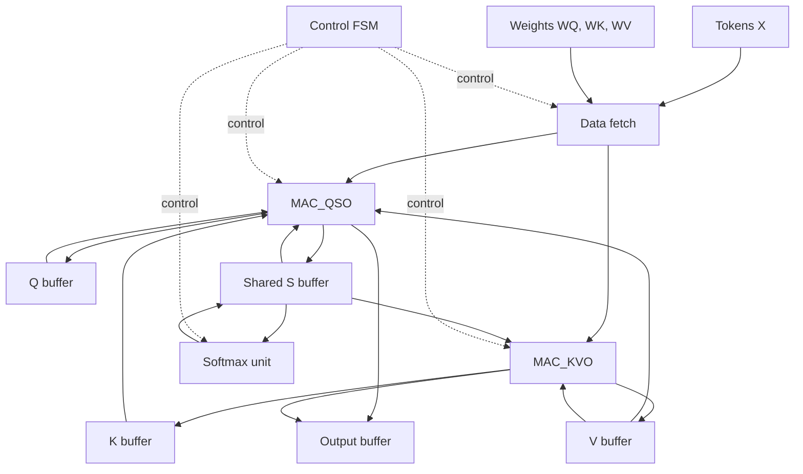

# Scaled Dot-Product Attention

Simplified scaled dot-product attention mechanism using Verilog 

## Toolchain

- **Simulator:** Icarus Verilog (`iverilog`), built from source [ICARUS Verilog](https://github.com/steveicarus/iverilog)
  - **Version:** Icarus Verilog version 14.0 (devel)
  - **Build Target:** MSYS2 UCRT64 environment (`x86_64-w64-mingw32`)
  - **OS:** Windows 10/11 (via MSYS2 UCRT64 Bash)
  - **Build Steps:** 
    1. Installed dependencies in MSYS2 UCRT64: `gcc`, `make`, `autoconf`, `bison`, `flex`, `gperf`.
    2. Cloned repository: 
        `git clone https://github.com/steveicarus/iverilog.git`
    3. Generated build scripts and configured target path: `autoconf && ./configure --prefix=/ucrt64`
    4. Compiled and installed binaries: `make install`

## Block diagram

The block diagram of the design for the scaled dot product attention is given below:

