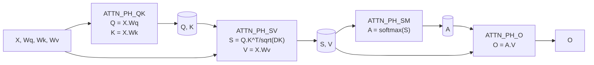
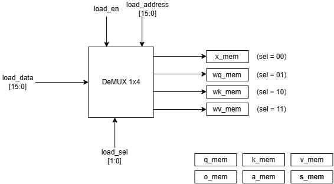
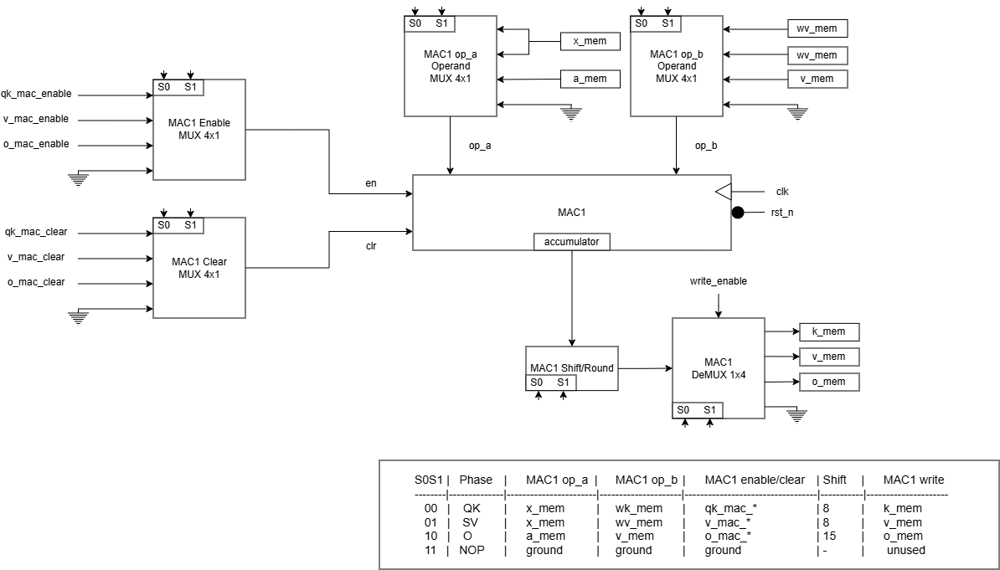
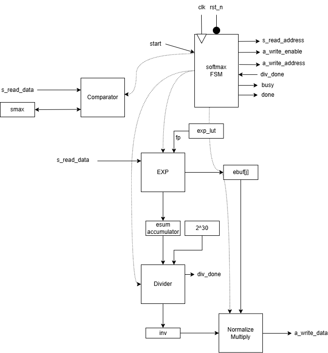

# Scaled Dot-Product Attention

Simplified scaled dot-product attention mechanism using Verilog.

The project implements scaled dot product attention as a hardware accelerator in Verilog, which is the operation inside a transformer model. Given four input matrices $(X, W_q, W_k, W_v)$, the design computes $O = \text{softmax}\left(\frac{QK^{T}}{\sqrt{d_k}}\right) V$.

The diagram below shows the general attention computation this design implements.


## Table of Contents

- [Computation](#computation)
- [Architecture](#architecture)
  - [Phase Diagram](#phase-diagram)
  - [Hardware Block Diagram](#hardware-block-diagram)
  - [Design Decisions](#design-decisions)
    - [Table 1: Architectural Decisions](#table-1-architectural-decisions)
    - [Table 2: Numeric Format Decision](#table-2-numeric-format-decision)
    - [Table 3: Sub-Module Implementation Decisions](#table-3-sub-module-implementation-decisions)
- [Files](#files)
- [Module Details](#module-details)
  - [mac_unit.v](#mac_unitv)
  - [divider.v](#dividerv)
  - [softmax_unit.v](#softmax_unitv)
  - [loop_control.v](#loop_controlv)
  - [attention.v](#attentionv)
- [File Formats](#file-formats)
  - [Input Files](#input-files)
  - [Output File](#output-file)
  - [Waveform Dump](#waveform-dump)
- [Verification and Results](#verification-and-results)
  - [How to Run](#how-to-run)
  - [Test](#test)
- [Constraints](#constraints)
- [Toolchain](#toolchain)
- [Limitations](#limitations)

## Computation
N = Number of tokens

DM = Model dimension (embedding size of each token)

DK = Key dimension (dimension of the projection space)

|Matrix 	| Shape 	| Meaning |
|-----------|-----------|---------|
|X	| $N \times DM$	|Input sequence|
|W_q, W_k, W_v	| $DM \times DK$	|Learned weights|
|Q, K, V|	$N \times DK$|	Projections|
|S|	$N \times N$|	Scaled attention scores|
|A	|$N \times N$	|Attention weights (probabilities)|
|O	|$N \times DK$	|Output|

Calculations:

$$Q = X \cdot W_q \quad \text{(Queries)}$$
$$K = X \cdot W_k \quad \text{(Keys)}$$
$$V = X \cdot W_v \quad \text{(Values)}$$
$$S = (Q \cdot K^T) / \sqrt{DK} \quad \text{(Raw scores, scaled)}$$
$$A = \text{softmax}(S) \quad \text{(Attention weights)}$$
$$O = A \cdot V \quad \text{(Output)}$$

Number formats:
|Signal|	Format	|Width	|Notes|
|---|---|---|---|
|$X, W_q, W_k, W_v$	|Q8.8 signed|	16|	Loaded from text files|
|$Q, K, V, S, O$	|Q8.8 signed|	16|	Computed by the design|
|$A$	|Q1.15 signed	|18	|Softmax output, 1.0 = 32768|
|Accumulator|	|40	|Internal, $A\_W + B\_W + \log_2(\text{DM})$ headroom|

## Architecture

The design uses only **two physical MACs**, shared across four computation phases through operand muxes.

### Phase Diagram
The simple phase diagram of the design for the scaled dot product attention is given below:


### Hardware Block Diagram


Figure: Loading data and memories in the design




Figure: MAC hardware block diagram



Figure: Softmax hardware block diagram

### Design Decisions

#### Table 1: Architectural Decisions
| Decision | Choice | Rationale |
|---|---|---|
| Phase order | QK $\rightarrow$ SV $\rightarrow$ SM $\rightarrow$ O | Follows data dependencies. Q and K must exist before S, S must exist before softmax, A and V must exist before O. The two MACs run in parallel within each phase where possible. |
| Multipliers | 2 shared MACs across all phases| Reduces from 6 multipliers (one dedicated set per phase) to 2. Requires operand muxes and prevents phase overlap, but no throughput target is specified for this design, so area savings dominate. |
| MAC architecture | Sequential (one multiply-accumulate per cycle) | A fully parallel version would use $N \times DK \times DM = 2 \times 4 \times 4 = 32$ multipliers for a single matmul or 64 for Q and K together. This design uses 2. |
| Phase 4 parallelism | JSTEP=2 (each iteration writes two output columns) | Both MACs are used simultaneously on adjacent output columns. Doubles the throughput of the $O$ phase at no extra hardware cost as the MACs would otherwise sit idle during $O$. |
| Control structure | Parameterized loop_ctrl, instantiated 4$\times$ | All four phases share the same loop nest structure $(i, j, k)$. The shared module is 83 lines and covers all four phases where inlining would mean four near-identical copies in the top level.|
| Pipelines | None (single-cycle FSM states) | The design prioritizes correctness and clarity over throughput. Adding pipeline stages would increase cycle efficiency but complicate the FSM handshakes and the operand muxes. |

#### Table 2: Numeric Format Decision
| Decision | Choice | Rationale |
|---|---|---|
| Arithmetic | Fixed-point Q8.8 / Q1.15 | Avoids the area and complexity of a floating-point unit. Q8.8 gives a resolution of 1/256 over the range [-128, 128), which is sufficient for this scale. The design enforces the range via saturation. |
| Attention weight storage | 18-bit signed | Q1.15 represents 1.0 as 32768, which doesn't fit in signed 16-bit (max 32767). 18-bit signed gives full Q1.15 range with 2 bits of headroom. |
| Rounding | Round-half-up before truncation | $(acc + (1 << (shift-1))) >>> shift$. Without the $+2^{(shift-1)}$ term, truncation would introduce a systematic −0.5 LSB bias on every result. |
| Saturation | Clamp to signed 16-bit | Results outside [-32768, 32767] are clamped rather than wrapped. Necessary because the 40-bit accumulator has more range than the 16-bit memory it writes to. |

#### Table 3: Sub-Module Implementation Decisions
| Decision | Choice | Rationale |
|---|---|---|
| Softmax exp | 256-entry LUT + right shift | $e^x = 2^{(x \cdot log_2e)}$ splits into an integer part (shift) and 8-bit fractional part (lookup). LUT storage is  256 $\times$ 16 = 512 bytes. Softmax output A matches the reference within $\pm18$ LSB (Q1.15). |
| Division | Single restoring divider, 34-cycle latency | One division per row to compute $\text{inv} = 2^{30}/\text{esum}$, then N multiplies by that reciprocal. Bit-serial restoring avoids the area of a pipelined divider. 34 cycles is the dominant cost of softmax, but softmax is only 1 of 4 phases. |
| Scaling by $\sqrt{DK}$ | Right shift | $DK$ restricted to powers of 4, so $\sqrt{DK} = 2^k$ shift, not a multiply |

## Files

| File | Module |Role |
|---|---|---|
| `HDL/mac_unit.v`|`mac`| Signed multiply-accumulate primitive |
| `HDL/loop_control.v` | `loop_ctrl`|Reusable loop-nest controller |
| `HDL/divider.v` | `divider` |Restoring divider for softmax reciprocal |
| `HDL/softmax_unit.v` |  `softmax`|Row-wise softmax with LUT exp |
| `HDL/attention.v` | `attention`|Top level: memories, muxes, FSM, integration |
| `scripts/reference.py` |-| Python reference model + input file generator |
| `scripts/compare.py` |-| Compares Verilog output vs. reference |

## Module Details

### mac_unit.v

- MAC (Multiply-Accumulate) unit multiplies two operands (`op_a` and `op_b`) and accumulates it on the accumulator (`accumulator`). At each clock pulse, it multiplies given two operands and then adds it to the accumulator.
- At each clock pulse:

|rst_n|	clear|	enable|Next acc|
|--|--|--|--|
|0|x|x|0 (reset)|
|1|1|x|0 (clear)|
|1|0|1|acc + op_a $\cdot$ op_b|
|1|0|0|unchanged|

Ports:

- Operands: op_a [17:0] signed, op_b [15:0] signed
- Control strobes: clr, en
- Accumulator: accumulator [ACC_W-1:0] signed

> [!Note]
> The MAC is reused across the four phases. In phases ATTN_PH_QK and ATTN_PH_SV  `op_a` carries Q8.8 values (16 bits). But in phase ATTN_PH_O, it carries Q1.15 attention weight (18 bits). That is why the operand port `op_a` is 18 bits wide.
>
> The 40-bit accumulator provides 6 bits of headroom, supporting up to 64 accumulated terms. For our DM=4, only 2 bits of that are actually used; the rest is margin.

### divider.v

- The divider uses unsigned restoring division algorithm for two `WIDTH`-bits operands.

Algorithm:

1. Shift the remainder left by one bit, bringing in the next bit of the dividend.
2. Subtract the divisor.
3. If the result is negative, restore the value and set the quotient bit to 0. Otherwise keep the result and set the quotient bit to 1.
4. Repeat `WIDTH` times.

FSM:

|State|	Purpose|
|--|--|
|IDLE|	wait for start, latch inputs|
|RUN|	one shift-subtract-restore per cycle|
|DONE|	latch the quotient to the output, pulse done|

### softmax_unit.v

- The softmax function is a mapping that takes a vector of scores/numbers and maps it to a vector of corresponding probabilities.
- For a vector $\vec{z} = [z_1, z_2, z_3, \ldots, z_K]$, the softmax formula is as follows: $\sigma(\vec{z})_i = \frac{e^{z_i}}{\sum_{j=1}^{K} e^{z_j}}$
- Every output is in $(0, 1)$ and outputs sum to 1.

#### Hardware Implementation
For each row of matrix $S$:
1. Find maximum value in each row (`smax`)
2. Compute $e^{S[i][j] - \text{smax}}$ for every column $j$, store it in buffer and accumulate the sum (`esum`).
3. Divide each exponent value by `esum`.

#### Why subtract max from each element?
If any $z_i$ is large (let it be 100), then $e^{100} \approx 2.7 \times 10^{43}$, which overflows fixed-point or 32-bit floating-point format. Even if only one value is large, the entire sum will blow up. So to overcome this, we subtract the maximum element of each row with individual elements of the row so that each element is less than or equal 0. This will bound the value of exponent from 0 to 1 ($e^{z_i - m} \in (0, 1]$), making it easier to compute with no overflow.

$$\sigma(\vec{z})_i = \frac{e^{z_i}}{\sum_{j=1}^{K} e^{z_j}}$$
$$ = \frac{e^{z_i} \times e^{-m}}{\sum_{j=1}^{K} e^{z_j}\times e^{-m}}$$
$$ = \frac{e^{z_{i}-m}}{\sum_{j=1}^{K} e^{z_{j}-m}}$$

Where, $m = max_k(z_k)$ is a constant for each row. With $m$ chosen as the row maximum, every exponent argument is $\le 0$.

FSM:

- SM_IDLE: wait for start pulse.
- SM_MAX: read the row, track `smax`.
- SM_EXP: read the row again, compute $e_j = e^{(S[i][j] - \text{smax})}$, store each $e_j$ in a buffer, accumulate the sum `esum`.
- SM_DIV:  pulse the divider to compute $inv = \frac{2^{30}}{\text{esum}}$.
- SM_DIV_WAIT: wait for divider's done pulse.
- SM_NORM: for each column, compute $A[i][j] = e_j \cdot \frac{inv}{2^{15}}$ and write it out.
- SM_FINISHED: go to `SM_IDLE`.

Exponential is calculated using LUT(LookUp Table). $e^x$ is computed using the identity $e^x = 2^{(x \cdot \log_2 e)}$. The exponent is split into an integer part `ip` (a right shift) and an 8-bit fractional part `fp` (a 256-entry lookup table). The LUT stores $\text{round}(32768 \cdot 2^{(-k/256)})$ for $k = 0..255$, in Q1.15 format.

Number formats:

|Signal|	Format|	Notes|
|--|--|--|
| $S$ (input) | Q8.8 signed | from the score computation |
| $e_j$ | Q1.15 unsigned | exponential value per column |
| esum | 17 bits unsigned | sum of $e_j$; width = $log_2(N) + 16$ |
| inv | Q1.15 unsigned, 17-bit | $2^{30}/\text{esum}$, always $\le$ 1.0 |
| $A$ (output) | Q1.15 signed, 18-bit | attention weights |

### loop_control.v

A parameterized loop-nest controller. It implements the triple loop as the following pseudocode and outputs the loop counters `i`, `j`, `k` plus three strobes: `mac_clear`, `mac_enable`, `write_enable`.

```    
for i in 0..NI-1
    for j in 0..NJ-1 step JSTEP
        for k in 0..NK-1:
          accumulate
        write
```

The same module is instantiated four times in `attention.v`, with different bounds for each phase:

| Instance | NI | NJ | NK | JSTEP | Phase |
|---|---|---|---|---|---|
| `u_qk` | N | DK | DM | 1 | ATTN_PH_QK |
| `u_s` | N | N | DK | 1 | ATTN_PH_SV |
| `u_v` | N | DK | DM | 1 | ATTN_PH_SV |
| `u_o` | N | DK | N | 2 | ATTN_PH_O |

The `JSTEP=2` case for `u_o` lets each iteration produce two output columns in parallel, one per MAC.

### attention.v

The top-level module. It owns all ten memories, instantiates two MACs, four `loop_ctrl` units, and one softmax unit, and sequences everything through a six-state FSM.

|Memory	|Size	|Role|
|--|--|--|
|x_mem, wq_mem, wk_mem, wv_mem|	input|	loaded from the file|
|q_mem, k_mem, v_mem|	intermediate	|projections|
|s_mem|	intermediate	|scaled scores|
|a_mem|	intermediate|	attention weights (18-bit)|
|o_mem|	output|	final result|

**Phases.** In order:
1. `ATTN_IDLE`: Does nothing, waits for start signal.
2. `ATTN_PH_QK`: MAC0 computes Q, MAC1 computes K in parallel.
3. `ATTN_PH_SV`: MAC0 computes S, MAC1 computes V in parallel.
4. `ATTN_PH_SM`: The softmax unit runs alone while MACs are idle.
5. `ATTN_PH_O`: MAC0 and MAC1 each compute one output column per iteration.
6. `ATTN_DONE`: Goes to state `ATTN_IDLE`.

Both **MACs** are used in every computation phase, only the operand sources change. This halves the number of multipliers compared to a dedicated-MAC-per-phase design.

**Operand muxes.** Both MACs are shared. Operand muxes, selected by the top FSM state, route the correct memories to each MAC in each phase. This is what makes 2 physical MACs cover the work of 6 logical ones.

**Load port.** A 4-way selector writes $X, W_q, W_k, W_v$ into their memories before the computation begins. `load_sel` chooses which memory, `load_address` is the row-major flat index.

**Output port.** A combinational read of `o_mem` at `read_address` exposes the final output without a clock delay.

## File formats

### Input files

Four files, one per input matrix, stored in `input/`:

| File | Matrix | Shape |
|---|---|---|
| `x.txt` | $X$ | $N \times DM$ |
| `wq.txt` | $W_q$ | $DM \times DK$ |
| `wk.txt` | $W_k$ | $DM \times DK$ |
| `wv.txt` | $W_v$ | $DM \times DK$ |

Each file is row-major, one 16-bit Q8.8 value per matrix element, in hexadecimal, whitespace-separated (any number per line).

Example (`x.txt` for N=2, DM=4):
```
    0100 0200 0000 0100
    0200 0000 0100 0100
```
Each hex word represents a real number scaled by $2^8$. For example:
- `0100` = 1.0
- `FF00` = -1.0
- `0080` = 0.5
- `0000` = 0.0

### Output file

After the simulation, `output/o.txt` contains the final $O$ matrix in Q8.8 hex format, row-major. The `output` folder also contains `expected_o.txt` generated from the Python script for comparison.

### Waveform dump

The testbench dumps all signals to `tb_attention.vcd` via `$dumpvars`.

## Verification and Results

### How to run
All commands below are run from the repo root.

```bash
# Step 1: Generate input files and reference outputs
cd scripts
python reference.py

# Step 2: Compile (from HDL/ directory because testbench uses relative paths)
cd ../HDL
iverilog -g2012 -o sim_attn.out mac_unit.v loop_control.v divider.v softmax_unit.v attention.v attention_tb.v

# Step 3: Run simulation
vvp sim_attn.out

# Step 4: Compare against reference (from scripts/ directory)
cd ../scripts
python compare.py
```
### Test

Expected values are computed by `scripts/reference.py`, which evaluates the same attention operation in floating-point rounded to the nearest Q8.8 integer. The comparison uses a tolerance of 2 LSB in Q8.8 units.

**Test1:** $N=2$, $DM=4$, $DK=4$ hand-worked example.

**Results:**

| Signal | Max Error | Tolerance | Status |
|---|---|---|---|
| $O$ (Q8.8) | 1 LSB | 2 LSB | PASS |

**Cycle count:** 177 cycles for $N=2$, $DM=4$, $DK=4$.


## Constraints
- `N >= 2`, `DM >= 2`, `DK >= 4`
- `DK` must be a power of 4 (so $\sqrt{DK}$ is a power of 2 and can be folded into a right shift)
- `DK` must be even (phase $O$ uses `JSTEP=2`)

All four checks are enforced by an `initial` block that calls `$fatal` at elaboration time.

## Toolchain

- **Simulator:** Icarus Verilog (`iverilog`), built from source [ICARUS Verilog](https://github.com/steveicarus/iverilog)
  - **Version:** Icarus Verilog version 14.0 (devel)
  - **Build Target:** MSYS2 UCRT64 environment (`x86_64-w64-mingw32`)
  - **OS:** Windows 10/11 (via MSYS2 UCRT64 Bash)
  - **Build Steps:** 
    1. Installed dependencies in MSYS2 UCRT64: `gcc`, `make`, `autoconf`, `bison`, `flex`, `gperf`.
    2. Cloned repository: 
        `git clone https://github.com/steveicarus/iverilog.git`
    3. Generated build scripts and configured target path: `autoconf && ./configure --prefix=/ucrt64`
    4. Compiled and installed binaries: `make install`

## Limitations

- **Simulation only.** The design is verified in Icarus Verilog but has not been synthesized or placed-and-routed on an FPGA.
- **Input range.** Q8.8 limits inputs to [-128, 128). Larger values will saturate on write-back.
- **Single sample per run.** The module processes one `(X, Wq, Wk, Wv)` set per `start` pulse. No batching or streaming.
- **Fixed problem size.** `N`, `DM`, `DK` are compile-time parameters. Changing them requires recompiling and regenerating the input files.
- **LUT-based exp accuracy.** The softmax uses an 8-bit fractional exponent LUT.
- **No pipelining.** Phases run strictly sequentially.